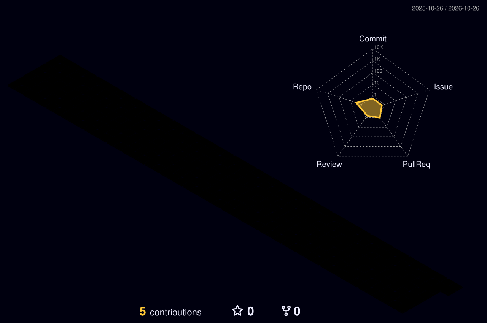

<!-- Banner neón -->

  

  

---

### 🏙️ La ciudad que construí este año

  

### 📊 Stats

  
  

  

### 🛠️ Stack

  

### 🐍 Mis contribuciones, devoradas

  <picture>
    <source media="(prefers-color-scheme: dark)" srcset="https://raw.githubusercontent.com/lbarrera27-pixel/lbarrera27-pixel/output/github-snake-dark.svg" />
    
  </picture>

  

